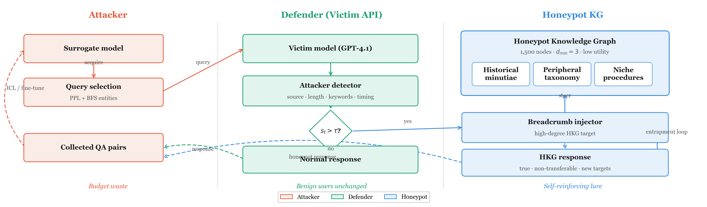

<div align="center">

# KnowledgeTrap

### Trapping Large Language Model Extraction Attacks with Knowledge Honeypot

**A paper-aligned code release for redirecting model extraction attacks toward factual, low-transferability knowledge through a Honeypot Knowledge Graph and breadcrumb-guided luring.**

<p>
  
  
  
  
  
  
  
</p>

<p>
  <a href="#quick-start"><b>Quick Start</b></a> ·
  <a href="#paper-to-code-map"><b>Paper-to-Code Map</b></a> ·
  <a href="#run-experiments"><b>Run Experiments</b></a> ·
  <a href="#honeypot-knowledge-graph"><b>HKG</b></a> ·
  <a href="#figures"><b>Figures</b></a> ·
  <a href="#repository-layout"><b>Layout</b></a>
</p>

<h3>HKG Construction · Attacker Detection · Breadcrumb Luring · ICL Agreement Evaluation · Paper Figures</h3>

</div>

---

<p align="center">
  
</p>

## What This Repository Contains

KnowledgeTrap defends closed-source LLM APIs from model extraction attacks by steering the attacker away from task-critical knowledge and into a **Honeypot Knowledge Graph (HKG)**. Instead of degrading all outputs or only detecting theft after the fact, the defender:

| Component | What it does | Main code |
|---|---|---|
| **Attacker loop** | PPL-style active querying, entity expansion, clustering, QA collection | [`trainStudent.py`](./trainStudent.py) |
| **HKG construction** | Generates factual, low-transferability candidate nodes and wires internal breadcrumbs | [`honeypot/build_hkg.py`](./honeypot/build_hkg.py) |
| **HKG repair/audit** | Removes modern/practical/high-utility nodes and repairs graph size/out-degree | [`honeypot/repair_hkg.py`](./honeypot/repair_hkg.py) |
| **Runtime defense** | Implements baseline, PRADA, output perturbation, HKG-only, detection-only, and full KnowledgeTrap modes | [`honeypot/honeypot_teacher.py`](./honeypot/honeypot_teacher.py) |
| **Agreement evaluation** | Evaluates ICL surrogate agreement against the victim on MedQA, MedMCQA, FinQA, and ConvFinQA | [`evaluate_icl_openrouter.py`](./evaluate_icl_openrouter.py) |
| **Adaptive attacker analysis** | Measures relevance-filter acceptance/rejection under adaptive filtering thresholds | [`adaptive_filter_analysis.py`](./adaptive_filter_analysis.py) |
| **Paper figures** | Regenerates the overview and experiment figures used in the paper draft | [`scripts/overview_figure.py`](./scripts/overview_figure.py), [`scripts/make_paper_figures.py`](./scripts/make_paper_figures.py) |

For a detailed section-by-section alignment, see [`CODE_MANIFEST.md`](./CODE_MANIFEST.md).

---

## News

- **2026-06-14** - README and code manifest updated to align the release with the current EMNLP draft and appendix structure.
- **2026-05-20** - Paper figures regenerated with Georgia typography and publication-ready single-panel/subfigure layouts.
- **2026-05-19** - ICL evaluation matrix completed for Medical and Financial benchmarks with OpenRouter-hosted victim, surrogate, and judge models.
- **2026-05-18** - Repaired Medical and Financial HKGs released with audit reports for practical/modern/high-transfer nodes.

---

## Quick Start

```bash
git clone https://github.com/<your-org>/KnowledgeTrap.git
cd KnowledgeTrap

python -m venv .venv
source .venv/bin/activate
pip install -r requirements.txt

export OPENROUTER_API_KEY="your_openrouter_key"
```

Run a small KnowledgeTrap full-defense collection:

```bash
python trainStudent.py \
  --STUDENT_BASE=sshleifer/tiny-gpt2 \
  --domain=medical \
  --MAX_QUERIES=200 \
  --Teacher_model=openai/gpt-4.1 \
  --defense_mode=full \
  --detection_threshold=0.6 \
  --hkg_size=1500 \
  --hkg_path=honeypot_hkg/medical_hkg_1500_repaired.json \
  --experiment_name=medical_full_B200_gpt41_icl \
  --skip_final_train=true \
  --with_correction=false
```

Evaluate the collected QA pairs with an OpenRouter-hosted ICL surrogate:

```bash
python evaluate_icl_openrouter.py \
  --run_name=medical_full_B200_gpt41_icl \
  --domain=medical \
  --benchmark=medqa \
  --qa_path=checkpoint/medical_full_B200_gpt41_icl_all_qa_pairs_200_200.json \
  --limit=50 \
  --max_demos=24 \
  --surrogate_model=meta-llama/llama-3.1-8b-instruct \
  --victim_model=openai/gpt-4.1 \
  --judge_model=openai/gpt-4o-mini \
  --output=results/medical_full_B200_gpt41_icl_medqa_agreement.json
```

---

## Paper-To-Code Map

| Paper item | Code / artifact |
|---|---|
| Threat model and active extraction | [`trainStudent.py`](./trainStudent.py), [`coq/`](./coq), [`followup/`](./followup), [`student/`](./student) |
| HKG construction | [`honeypot/build_hkg.py`](./honeypot/build_hkg.py), [`honeypot_hkg/`](./honeypot_hkg) |
| Transferability and inaccessibility filtering | [`honeypot/build_hkg.py`](./honeypot/build_hkg.py), [`honeypot/repair_hkg.py`](./honeypot/repair_hkg.py), [`HKG_AUDIT_SUMMARY.md`](./HKG_AUDIT_SUMMARY.md) |
| Detection and luring | [`honeypot/honeypot_teacher.py`](./honeypot/honeypot_teacher.py) |
| Algorithm 1 full pipeline | [`trainStudent.py`](./trainStudent.py) + [`honeypot/honeypot_teacher.py`](./honeypot/honeypot_teacher.py) |
| RQ1 main results | [`run_icl_matrix.sh`](./run_icl_matrix.sh), [`evaluate_icl_openrouter.py`](./evaluate_icl_openrouter.py), generated `results/` JSON |
| RQ2 ablations | `--defense_mode=hkg_only`, `--defense_mode=detection_only`, `--defense_mode=full` |
| RQ3 budget allocation | `*_honeypot_budget.jsonl`, [`scripts/make_paper_figures.py`](./scripts/make_paper_figures.py) |
| RQ4 sensitivity | [`run_sensitivity_threshold.sh`](./run_sensitivity_threshold.sh), [`run_sensitivity_hkg_size.sh`](./run_sensitivity_hkg_size.sh) |
| RQ5 adaptive attacker | [`adaptive_filter_analysis.py`](./adaptive_filter_analysis.py) |
| Appendix B judge ablation | `--judge_model` in [`evaluate_icl_openrouter.py`](./evaluate_icl_openrouter.py) |
| Appendix E breadcrumb templates | `BreadcrumbTemplates` in [`honeypot/honeypot_teacher.py`](./honeypot/honeypot_teacher.py) |
| Figures | [`scripts/overview_figure.py`](./scripts/overview_figure.py), [`scripts/make_paper_figures.py`](./scripts/make_paper_figures.py), generated `figures/` assets |

The bundled release contains paper-scale Medical and Financial HKGs with 1,500 nodes per domain and minimum out-degree $d_\mathrm{min}=3$.

---

## Honeypot Knowledge Graph

Bundled HKG files:

```text
honeypot_hkg/medical_hkg_1500_repaired.json
honeypot_hkg/financial_hkg_1500_repaired.json
```

Each node stores:

```json
{
  "node_id": "hkg-medical-0001",
  "topic": "Early 20th Century Medical Device Patent Registries",
  "question": "...",
  "answer": "...",
  "breadcrumbs": ["...", "...", "..."],
  "utility_score": 0.0,
  "attractiveness_score": 0.9,
  "inaccessibility_score": 0.8
}
```

Build a new HKG:

```bash
python honeypot/build_hkg.py \
  --domain medical \
  --size 1500 \
  --model google/gemini-2.5-flash-lite \
  --output honeypot_hkg/medical_hkg_1500.json
```

Repair and audit it:

```bash
python honeypot/repair_hkg.py \
  --domain medical \
  --input honeypot_hkg/medical_hkg_1500.json \
  --output honeypot_hkg/medical_hkg_1500_repaired.json \
  --size 1500
```

Repair reports are written next to the repaired HKG:

```text
honeypot_hkg/medical_hkg_1500_repaired.expansion_report.json
honeypot_hkg/financial_hkg_1500_repaired.expansion_report.json
```

---

## Run Experiments

### Main ICL Matrix

```bash
PYTHON_BIN=python \
TEACHER_MODEL=openai/gpt-4.1 \
SURROGATE_MODEL=meta-llama/llama-3.1-8b-instruct \
JUDGE_MODEL=openai/gpt-4o-mini \
DOMAINS="medical financial" \
BUDGETS="100 200 300 500" \
MODES="baseline prada output_perturbation full" \
bash run_icl_matrix.sh
```

### Full Defense Modes

| Mode | Meaning |
|---|---|
| `baseline` | No defense, normal victim API responses |
| `prada` | Detection-style rate limiting |
| `output_perturbation` | Light response perturbation baseline |
| `hkg_only` | HKG exists, but no active detection-triggered luring |
| `detection_only` | Detection active, no breadcrumb-guided HKG redirection |
| `full` | Detection + breadcrumb injection + HKG response loop |

### Sensitivity

```bash
bash run_sensitivity_threshold.sh
bash run_sensitivity_hkg_size.sh
```

### Adaptive Attacker

```bash
python adaptive_filter_analysis.py \
  --domain medical \
  --input results/medical_full_B200_gpt41_icl_structured_log.json \
  --output results/medical_full_B200_gpt41_icl_adaptive_filter.json \
  --thresholds 0.3,0.5,0.7
```

---

## Benchmarks

`evaluate_icl_openrouter.py` supports:

| Domain | Benchmark flag | Notes |
|---|---|---|
| Medical | `medqa` | Multiple-choice MedQA / USMLE-style QA |
| Medical | `medmcqa` | Multiple-choice MedMCQA |
| Financial | `finqa` | Open financial reasoning; uses semantic judge |
| Financial | `convfinqa` | Conversational financial reasoning; uses semantic judge |
| Custom | `jsonl` | Expects `question` or `prompt` field |

---

## Figures

Regenerate all paper figures:

```bash
MPLCONFIGDIR=/tmp/mplconfig \
XDG_CACHE_HOME=/tmp/xdgcache \
python scripts/overview_figure.py

MPLCONFIGDIR=/tmp/mplconfig \
XDG_CACHE_HOME=/tmp/xdgcache \
python scripts/make_paper_figures.py
```

Generated outputs:

```text
figures/overview_figure.pdf
figures/agreement_curve_medqa.pdf
figures/agreement_curve_finqa.pdf
figures/budget_allocation.pdf
figures/hkg_size_medical.pdf
figures/hkg_size_financial.pdf
```

Example LaTeX:

```latex
\begin{figure*}[t]
\centering
\includegraphics[width=\textwidth]{figures/overview_figure.pdf}
\caption{Overview of KnowledgeTrap.}
\label{fig:overview}
\end{figure*}
```

---

## Repository Layout

```text
KnowledgeTrap/
  trainStudent.py                  # active extraction loop + defense wrapper
  evaluate_icl_openrouter.py        # ICL agreement evaluation
  adaptive_filter_analysis.py       # adaptive attacker filtering analysis
  honeypot/
    build_hkg.py                    # HKG candidate generation and filtering
    repair_hkg.py                   # practical/modern node repair
    hkg.py                          # graph loader and traversal utilities
    honeypot_teacher.py             # runtime defense layer
  honeypot_hkg/
    medical_hkg_1500_repaired.json
    financial_hkg_1500_repaired.json
  scripts/
    overview_figure.py
    make_paper_figures.py
  figures/                          # paper-ready PDF/PNG figures
  CODE_MANIFEST.md
  HKG_AUDIT_SUMMARY.md
  requirements.txt
```

---

## Reproducibility Notes

- Keep API keys in environment variables. Do not commit them.
- The low-cost ICL path uses `--skip_final_train=true`; LoRA-style training code remains available through the standard `trainStudent.py` path.
- Financial open-ended benchmarks use a judge model for semantic agreement.
- The bundled HKGs are 1,500-node paper-scale releases. The first 500 nodes are curated repaired seeds; the remaining nodes are deterministic archival variants generated by [`scripts/expand_hkg_to_1500.py`](./scripts/expand_hkg_to_1500.py).
- Large `checkpoint/`, `TeacherAns/`, `EQCache/`, `EntityQA/`, `logs/`, and `results/` files are generated experiment artifacts and are intentionally excluded from the upload-ready release.

---

## How To Cite

```bibtex
@inproceedings{anonymous2026knowledgetrap,
  title = {Let Them Steal: Trapping Large Language Model Extraction Attacks with Knowledge Honeypot},
  author = {Anonymous},
  booktitle = {Submission},
  year = {2026}
}
```

---

<div align="center">

**KnowledgeTrap turns the attacker's query budget into the defender's resource.**

</div>
